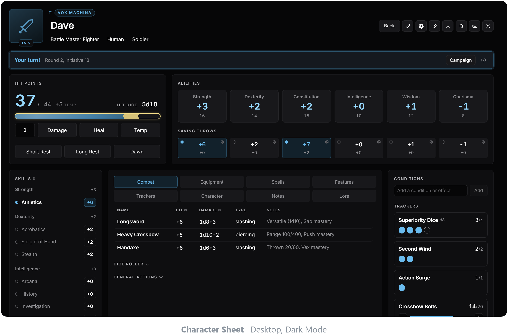
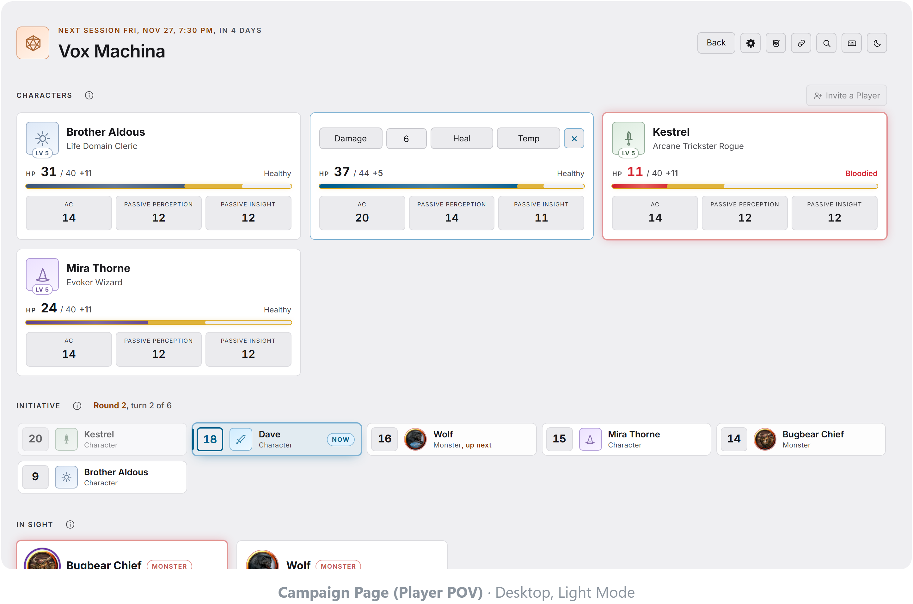
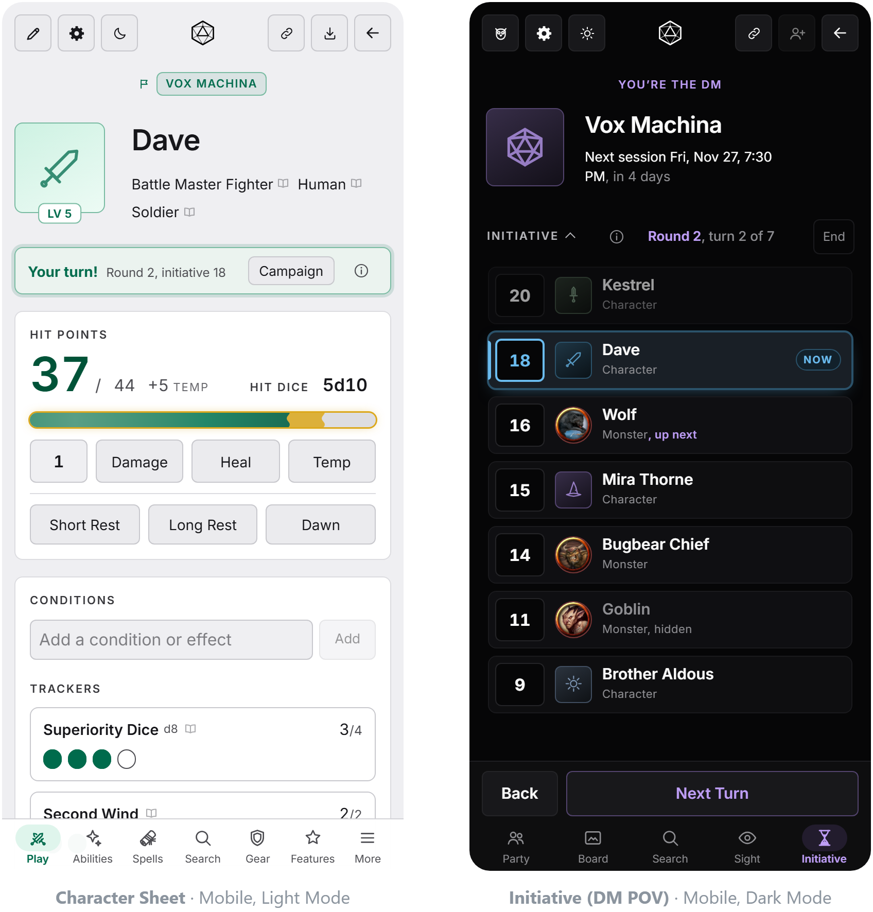

<p align="center">
  <picture>
    <source media="(prefers-color-scheme: dark)" srcset=".github/readme/brand-dark.png">
    
  </picture>
</p>

<p align="center">
  <a href="https://dndcompanion.krispypcl.workers.dev/DNDCompanion/"><b>Try the app</b></a>
  &nbsp;·&nbsp;
  <a href="https://dndcompanion.krispypcl.workers.dev/DNDCompanion/owlbear/manifest.json"><b>Owlbear Rodeo manifest</b></a>
</p>

## Overview

DND Companion is a D&D 5e character sheet built for one table of friends. It
does the arithmetic so the game doesn't stop for it, keeps the rules a press
away, and puts the whole party on one live page for the DM.

- **A sheet that keeps up.** Modifiers, saving throws, armor class, spell save
  DC, and the rest are worked out from what the character has and wears, and
  every number can explain itself. Anything the rules don't cover is written
  by hand, so homebrew sits as comfortably as anything from the books.
- **The rules beside you.** Every class, spell, item, feature, and monster opens
  straight from [5e.tools](https://5e.tools/), and <kbd>/</kbd> searches every
  book.
- **A table that's live.** In a campaign the DM sees each character's hit
  points and conditions as they change, runs initiative, keeps monsters and
  NPCs with their stat blocks and reveals them when the party finds them. The
  table shares its music and a board to draw on.
- **Yours to keep.** A sheet saves to a printable PDF that carries the whole
  character inside it, so the same file can bring it back. Notes and lore can
  stay private.
- **Anywhere you play.** It's laid out for a phone as well as a computer,
  installs like an app, and joins an [Owlbear Rodeo](https://www.owlbear.rodeo/)
  map through its extension.

## Showcase

<p align="center">
  
</p>
<p align="center">
  
</p>
<p align="center">
  
</p>

## Usage

### In app

1. **Sign up** with an email, Google, or Discord.
2. **Make a character** with **New Sheet**, then the pencil to fill it in; it
   saves as you go. The cog beside it sets the sheet's look: portrait,
   banner, color, music, and sounds. <kbd>?</kbd> lists the keyboard
   shortcuts.
3. **Share it** by its link. The down arrow saves it as a printable PDF, and
   **Import** in the main menu brings the character back from that PDF.
   Edits made inside the PDF don't come back, and saving the PDF again from
   another app can leave the character out.
4. **Start a campaign** from the main menu's Campaigns and send the players its
   invite (**Invite a Player**); each picks a character to bring. The DM's cog holds the
   campaign's settings, from the next session's date to its Owlbear room.
5. **Install it** from the browser's menu: *Add to Home Screen* on a phone,
   *Install app* on a computer. On a phone the main menu shows the way.

### In Owlbear Rodeo

1. In a room, choose **Extensions → Add custom extension** and paste the
   manifest link above.
2. Open DND Companion from the toolbar and paste the campaign's link: its
   characters join the room, live.
3. **Place token** puts a character on the map in their portrait (or
   right-click a token to tie it to one); its hit point bar and conditions
   follow the sheet, and rolls from the sheets pop up for everyone.
4. **Signed in as the DM**, the panel runs the fight too: initiative, and the
   monsters and NPCs with their stat blocks and tokens. Players see a
   revealed creature only as hurt as it looks.

## Framework

- [SvelteKit](https://svelte.dev/docs/kit) 3 with Svelte 5 and Vite, built as
  a static site (`@sveltejs/adapter-static`) and written in TypeScript
- [Supabase](https://supabase.com/): PostgreSQL with row-level security for
  the data, Supabase Auth for sign-in (email, Google, Discord) and Realtime for
  live updates and who is online
- [GitHub Pages](https://pages.github.com/) for hosting, served through
  Cloudflare; every push to `main` is tested and deployed by GitHub Actions
- The [Owlbear Rodeo SDK](https://docs.owlbear.rodeo/) for the extension
- [5e.tools](https://5e.tools/) data, read in the browser, for the rules pop-ups,
  and a search index of it built by `npm run search-index`
- The [Web Audio API](https://developer.mozilla.org/docs/Web/API/Web_Audio_API)
  for every sound effect and button sound, made on the spot (no sound files)
- [Vitest](https://vitest.dev/) and Testing Library for the tests

## Local Development

To run your own copy for yourself and your table (see [License](#license)).

The app runs on [Supabase](https://supabase.com/): its database, sign-in and
live updates all come from one Supabase project.

1. Create a Supabase project. In its SQL editor, run `schema.sql` once. Turn on
   email confirmation under Authentication → Providers → Email; Google and
   Discord are optional there too.
2. Create a `.env` in the project folder with the project's URL and anon key
   (Project Settings → API):

   ```
   PUBLIC_SUPABASE_URL=https://your-project.supabase.co
   PUBLIC_SUPABASE_ANON_KEY=your-anon-key
   ```

3. Install and start it (Node 24.15 or newer, or Node 26):

   ```bash
   npm install
   npm run dev
   ```

4. Check it: `npm test` runs the tests and `npm run check` the type checker.
   `npm run build` makes the static site in `build/`. Set `PUBLIC_SITE_URL`
   to the site's public address (it names the link previews), and
   `BASE_PATH` (for example `/DNDCompanion`) when it will be served from a
   sub-folder.

## License

The DND Companion Personal Use License (see [LICENSE](LICENSE)). You may use the code, change it, and run your own copy for yourself and the people you play with, free of charge. You may not sell it, charge for it, or put ads on it; publish or share it or your changes; offer a copy to the public; or train AI on it. Playing on the hosted app is always welcome. The sound effects, fonts, and packages it uses keep their own licenses.
